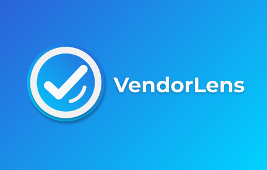

<p align="center">
  
</p>

# VendorLens

VendorLens ist eine Browser-Erweiterung für Google Chrome und Mozilla Firefox, die Produkt- und Händlerinformationen auf Amazon analysiert. Sie hilft dabei, Verkäufer aus bestimmten Regionen (wie China oder der EU) direkt auf der Suchergebnisseite transparent zu markieren oder auszublenden.

## Features

* **Händler-Erkennung:** Automatische Analyse der Verkäuferdaten im Hintergrund.
* **Visuelle Badges:** Hebt EU-Händler und andere definierte Verkäufergruppen optisch hervor.
* **Filter-Funktion (Hide China):** Blendet Produkte von chinesischen Händlern auf Wunsch komplett aus den Suchergebnissen aus.
* **Badge-Counter:** Zählt gefundene Händler und zeigt die Anzahl direkt am Extension-Icon an.
* **Master-Switch:** Die gesamte Erweiterung lässt sich mit einem Klick im Popup de- oder aktivieren.

## Architektur & Tech Stack

Das Projekt nutzt eine einheitliche Codebasis (Single Source of Truth) im `app/`-Ordner und generiert über ein Node.js-Build-Skript automatisch die passenden Manifest-Dateien für Chrome (Manifest V3 mit Service Worker) und Firefox (Manifest V3 mit Background Scripts).

* **Vanilla JavaScript** (keine externen Frameworks)
* **Manifest V3**
* **Node.js** (für den Build-Prozess)

## Entwicklung & Build-Prozess

Um an der Extension zu arbeiten oder die fertigen Dateien für den Browser zu generieren, benötigst du [Node.js](https://nodejs.org/).

1. Klone das Repository.
2. Nimm deine Code-Änderungen ausschließlich im `app/`-Ordner vor.
3. Führe das Build-Skript im Hauptverzeichnis aus:

    ```bash
    npm run build
    ```

**Ablauf des Build-Prozesses:**
1. Die Verzeichnisse dist/ und releases/ werden bereinigt.
2. Die Quelldateien aus dem Ordner app/ werden für Chrome und Firefox getrennt aufbereitet.
3. Die Versionsnummer aus der package.json wird automatisch in die Manifest-Dateien und in die HTML-Datei unter app/src/popup/hello.html geschrieben.
4. Fertige Archiv-Dateien (.zip) inklusive Versionsnummer im Namen werden im Ordner releases/ erstellt.

## Lokales Testen

**Google Chrome:**
1. Navigiere zu `chrome://extensions/`
2. Aktiviere oben rechts den "Entwicklermodus".
3. Klicke auf "Entpackte Erweiterung laden" und wähle den Ordner `dist/chrome` aus.

**Mozilla Firefox:**
1. Navigiere zu `about:debugging`
2. Klicke links auf "Dieser Firefox".
3. Klicke auf "Temporäres Add-on laden..." und wähle die `manifest.json` aus dem Ordner `dist/firefox` aus.

## Projektstruktur

| Verzeichnis / Datei | Beschreibung |
| :--- | :--- |
| app/ | Quellcode der Erweiterung (HTML, JS, CSS, Icons). |
| dist/ | Vom Build-Skript generierte, lauffähige Browser-Ordner. |
| releases/ | Automatisch generierte Zip-Archive für den Store-Upload. |
| build.js | Das Automatisierungsskript für Build und Packaging. |
| package.json | Zentrale Projektkonfiguration, Versionierung und Abhängigkeiten. |


## Lizenz

Alle Rechte Vorbehalten
Die Nutzung, Vervielfältigung oder Verbreitung des Codes ist ohne ausdrückliche Genehmigung des Urhebers nicht gestattet.